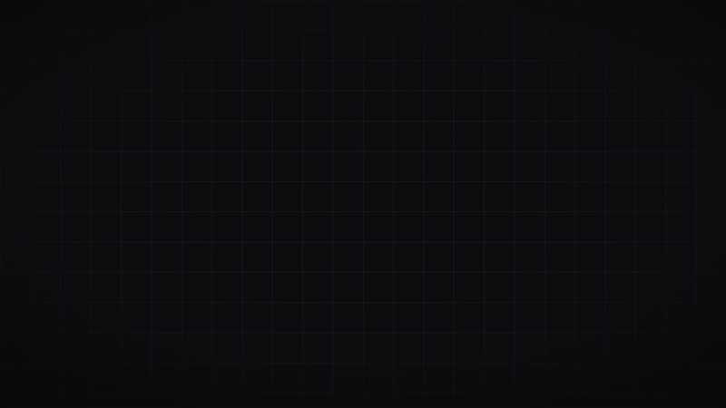
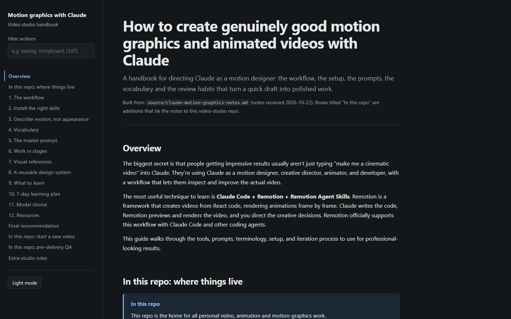

# Video Studio

A personal studio for making motion graphics and animated videos with Claude Code: a Remotion project, a prompt library, Claude Code skills, a shot library, research and an illustrated guide, all in one repo.

**Website: https://annasmustafadev.github.io/video-studio/** (tour, guide, skills, prompts, studio components, techniques, shot library, research and a gallery of 73 Claude-made motion videos).

The idea: Claude works as creative director, motion designer, animator and engineer, and you direct it stage by stage. You don't ask for a whole video in one shot. Every frame is rendered from code, and quality is judged on rendered frames, never on the code.



<sub>The library showcase (15 s, 1920x1080, 30 fps), built from the components in <code>studio/src/lib</code>. Full quality with sound: <a href="docs/media/showcase.mp4">showcase.mp4</a>.</sub>

## Demo

### The guide

[`guide/index.html`](guide/index.html) is a single offline page with every prompt behind a copy button, a section filter and light and dark themes.



## Examples

What to type in Claude Code, and which part of the studio picks it up.

| You ask | What happens | Uses |
|---|---|---|
| "I want a 20 s launch teaser for my side project. Give me three creative directions, no code yet." | Three genuinely different directions (look, type, pacing, transitions, sound), one recommended with reasons | `motion-director`, `prompts/10` |
| "Direction B. Storyboard it." | A timed scene table: first and last frame, focal point, exact text, motion, easing, transition, sound cue per scene, plus a hits table | `motion-director`, `prompts/11` |
| "Build scene 1 only and show me the stills." | One scene in `studio/src/videos/<slug>/`, rendered stills and a contact sheet that Claude actually looks at and fixes | `remotion-studio`, `prompts/12` |
| "Strict review." | A fresh reviewer scores nine dimensions from the rendered frames and lists the five worst defects with fixes | `motion-review`, `prompts/13` |
| "Find me product UI animations on prompt-motion that use a phone." | Three to five matches with the original prompt, author credit and a link to watch, then a proper brief from the one you pick | `prompt-motion-search`, `prompts/21` |
| "Analyse this reel and make something with the same feel for my app." | A breakdown of composition, type, motion, timing and sound, separating what is observed from what is guessed, then a plan that keeps the principles but not the branding | `motion-director`, `prompts/20` |
| "Make the 9:16 and 1:1 versions." | Each format recomposed for its own frame and safe margins | `remotion-studio`, `prompts/52` |
| "/brag" (inside a project you just built) | A 15 to 25 s launch video of that project in one command | `brag` |

More recipes (launch teaser, YouTube explainer, Instagram reel, data story, UI demo) are in [`prompts/INDEX.md`](prompts/INDEX.md).

## What's inside

| Path | What it is |
|---|---|
| [`studio/`](studio/) | Remotion 4 project (React, frame-based). Component library in `src/lib/` (titles, kinetic type, captions, lower thirds, counters, charts, transitions, backgrounds, sound cues), design tokens, [`DESIGN_SYSTEM.md`](studio/DESIGN_SYSTEM.md), a lock file for the official Remotion agent skills (`npx remotion skills add`), and a `_template` for new videos |
| [`prompts/`](prompts/) | Prompt library. [`prompts/INDEX.md`](prompts/INDEX.md) says which prompt to use for which purpose, and in what order |
| [`skills/`](skills/) | Claude Code skills (see below). Installed into `~/.claude/skills` with `node tools/install-skills.mjs` |
| [`third_party/`](third_party/) | Vendored third-party material (brag, video-shotcraft), pinned to an upstream commit and never edited here (each has an `UPSTREAM.md` with source, licence and how to update). The same install script installs them |
| [`docs/`](docs/) | The source of the [website](https://annasmustafadev.github.io/video-studio/): a generator (`docs/_build/`) that builds every page from this repo. Rebuild with `node docs/_build/build.mjs` |
| [`shot-library/`](shot-library/) | 51 curated motion shots with build notes for Remotion and the HTML engine and a taste verdict for each, adapted from [video-shotcraft](https://github.com/Vincentwei1021/video-shotcraft) (Apache-2.0). Open `shot-library/index.html` |
| [`research/`](research/) | What the community's Claude-made motion videos teach: a gallery of 73 videos (`research/gallery/`) and 50 analysed findings with what landed in this studio and why (`research/findings/`) |
| [`guide/index.html`](guide/index.html) | Self-contained illustrated guide: workflow, tools, setup, prompting, motion vocabulary, master prompt, staged prompts, references, design system, learning path. Open it in a browser |
| [`learning/`](learning/) + [`prompts/learning/`](prompts/learning/) | A 7-day learning plan, with one ready prompt per day |
| [`source/`](source/) | The notes this repo was built from |
| `projects/<date>-<slug>/` | One paper trail per video: brief, directions, storyboard, review, notes (renders stay local) |

## Skills

| Skill | Use it for |
|---|---|
| `motion-director` | Creative direction with no code: a 10-ingredient brief, three distinct directions, a timed storyboard with a hits table, reference breakdowns |
| `remotion-studio` | Building and rendering videos in `studio/` with the staged workflow, frame checks and a delivery report. The default engine |
| `motion-studio` | Voice-over-driven product films in a single HTML composition, where every cut lands on a spoken word |
| `motion-review` | A strict, independent review of rendered frames: scores, top defects, a verdict. Best run as a subagent |
| `prompt-motion-search` | Searching [prompt-motion.com](https://prompt-motion.com) for animations made with Claude, then turning a chosen prompt into a proper brief (credited, on demand) |
| `shot-library` | Picking and parameterising a concrete shot for every scene of a storyboard from the curated library, with a taste check against the studio's house rules |
| `brag`, `brag-slim` | **Third-party, MIT** ([latent-spaces/brag](https://github.com/latent-spaces/brag), vendored in [`third_party/brag/`](third_party/brag/UPSTREAM.md)). A quick 15 to 25 s launch video of a project you just built, in one command, written to `brag-output/` in that project. `brag-slim` needs no extra tools; full `brag` uses Hyperframes |

## Quick start

Prerequisites: Node 20.19+ (24 recommended), ffmpeg on PATH, [Claude Code](https://claude.com/claude-code).

```bash
git clone https://github.com/AnnasMustafaDev/video-studio.git
cd video-studio
node tools/install-skills.mjs        # copies skills/ into ~/.claude/skills (backs up existing ones)
cd studio
npm install
npx remotion skills add             # official Remotion agent skills (pinned in skills-lock.json)
npm run stills -- LibraryShowcase 50,130,245,350,449   # renders frames + a contact sheet
npm run dev                                           # Remotion Studio preview
```

The skills write this repo as `{{VIDEO_STUDIO}}`; the install script replaces it with the absolute path of your clone, so they work wherever you cloned it.

Then, in a second terminal in the repo root, run `claude` and start with a brief:

```
New video: 15 s Instagram reel (9:16, 30 fps) about <topic>.
Goal: <what it should achieve>. Mood: <calm / bold / ...>.
Look: <background>, <type colour>, one <accent> accent.
Exact text: "<line 1>" then "<line 2>".
Reference: <image or video path>.
Start with 3 creative directions. No code yet.
```

## The workflow

1. **Direction:** three genuinely different looks, pick one (`prompts/10`)
2. **Storyboard:** a timed scene table with exact text, motion, easing, transitions and sound cues (`prompts/11`)
3. **One scene:** build it, render stills, look at them, fix (`prompts/12`)
4. **Review:** a strict director review, top five defects, re-render (`prompts/13`)
5. **The rest:** remaining scenes one at a time, then sound, formats and final render (`prompts/14`, `50` to `53`)
6. **Post-mortem:** lessons go back into the skills (`prompts/70`)

Rules that hold throughout: deterministic, frame-based animation only (`useCurrentFrame`, `interpolate`, `spring`, no CSS transitions, timers or `Math.random`); one focal point per scene; real numbers only; -14 LUFS / -1 dBTP; and never claim a video was visually checked unless the frames were actually looked at.

## Licences

- Remotion is free for individuals and companies with up to 3 employees; larger companies need a [company licence](https://remotion.dev/license).
- Prompts found through `prompt-motion-search` belong to their authors and are always credited.
- `third_party/brag/` is MIT (Shunit Haviv Hakimi). Its bundled music is CC BY 4.0 (Sascha Ende, ende.app) and must be credited in any published video that uses it; its SFX are CC0.
- Sound effects in `studio/` are generated with ffmpeg, so they have no licence questions.
